<p align="center">
  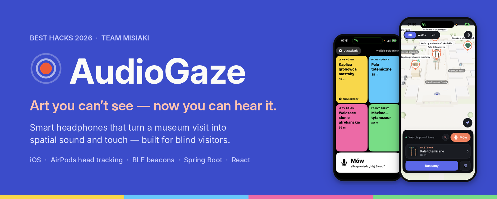
</p>

<p align="center">
  
  
  
  
  
</p>

<p align="center">
  <b>BEST Hacks 2026 · Team MISIAKI</b><br>
  Stanisław Sikora · Filip Urbanek · Anna Kaczmarczyk · Stanisław Trojanowski
</p>

---

## The problem

Museums rely mostly on **one sense**. Art stays behind glass, and blind visitors are cut off from experiencing it on
their own. Instead of theorising about exclusion, we built something that removes the barrier.

## What AudioGaze does

AudioGaze turns a phone and a pair of head-tracking headphones into a guide that works **without looking**:

- **Spatial sound leads the way.** A soft "bloop" plays from the direction you should walk. Turn the wrong way and it
  speeds up and drops in pitch; face the right way and you hear a chime and feel a tap.
- **The phone knows where you are.** BLE beacons on the walls plus your own steps give your position indoors, no GPS.
- **The headphones know where you look.** AirPods head tracking keeps every sound fixed in the room and turns the
  3D map with your head.
- **Stories start on their own.** Reach an exhibit and the guide tells its story. Ask for more with your voice.

### Head tracking in real time

<p align="center">
  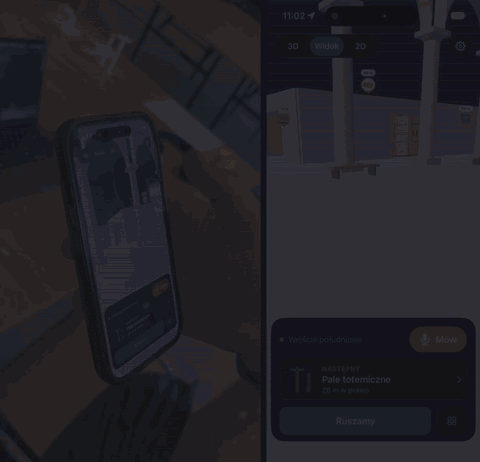
</p>
<p align="center"><sub>Left: the visitor with AirPods. Right: the app. Two phones, synced frame by frame.</sub></p>

<table align="center">
  <tr>
    <td align="center" width="50%">
      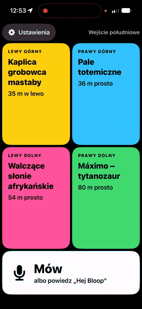
      <br><b>Listening mode</b><br><sub>Tap a corner, tap again (or say "tak"), and walk.</sub>
    </td>
    <td align="center" width="50%">
      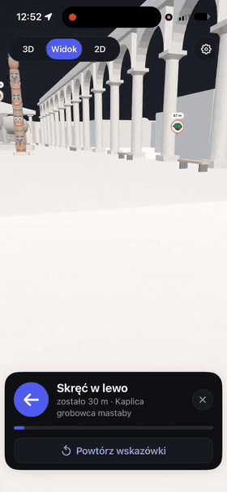
      <br><b>First-person view</b><br><sub>A coral path and live hints lead to the exhibit.</sub>
    </td>
  </tr>
</table>

## How a visit works

| | Step | What happens |
|---|---|---|
| **1** | **Start and sync** | Log in, put on the headphones and calibrate for 3 seconds at the entrance. |
| **2** | **Hot and cold, by ear** | Pick an exhibit. The sound comes from the way to go and changes as you turn toward it. |
| **3** | **The story** | About 2.5 m from the exhibit the guide recognises it and starts its story by itself. |
| **4** | **Ask more** | Voice commands: *opowiedz* (tell me), *dalej* (next), *powtórz* (repeat), *gdzie jestem* (where am I), *którędy* (which way). Or just say **"Hej Bloop"**. |

## The app

<table>
  <tr>
    <td align="center">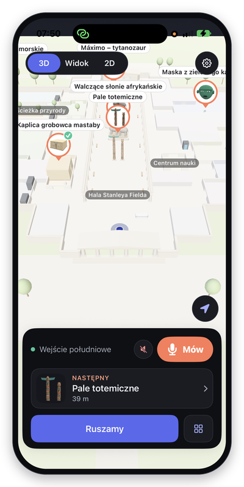<br><b>3D map</b><br><sub>turns with your head</sub></td>
    <td align="center">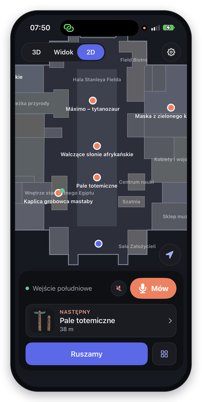<br><b>2D plan</b><br><sub>position from beacons</sub></td>
    <td align="center">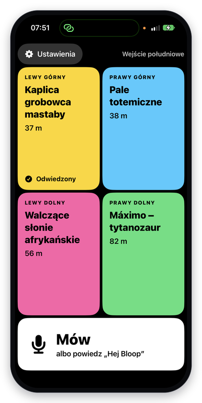<br><b>Listening mode</b><br><sub>4 nearest exhibits</sub></td>
    <td align="center">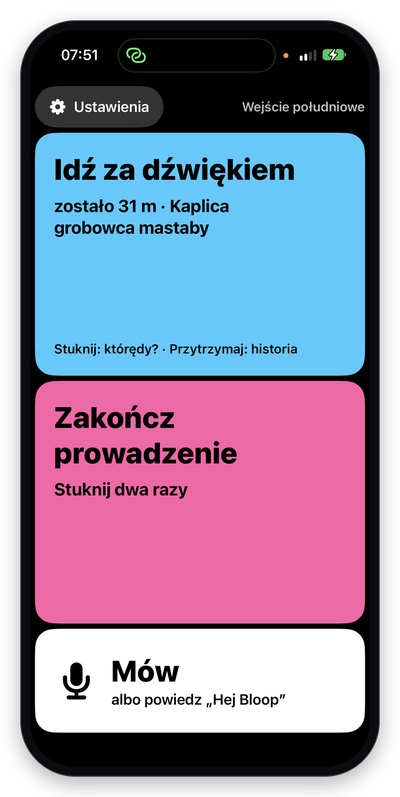<br><b>Follow the sound</b><br><sub>guides without looking</sub></td>
    <td align="center">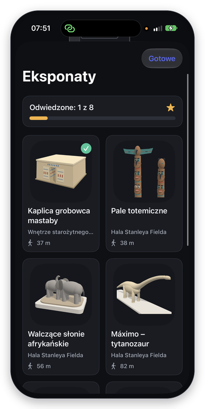<br><b>Collection</b><br><sub>visit progress</sub></td>
  </tr>
</table>

**Built for blind and low-vision visitors.** In listening mode the screen is four big coloured corners, one for each
of the four nearest exhibits, read aloud from their own directions. Tap once to choose, twice to go. Every step is
confirmed by a distinct vibration (three knocks to start, a long buzz to choose, long-short-long to confirm), and
everything also works by voice.

**Also in the app:** Polish and English (screens, voice and exhibit stories), natural voices from ElevenLabs, three
bloop rhythms (*Guiding*, *Calm*, *Chill*), and a demo walk for showing the app without walking.

## The museum in 3D

We rebuilt the main level of the **Field Museum (Chicago)** from open data, with eight exhibits. The same model gives
the bird's-eye map and the visitor's-eye view, and the same process works for any museum.

<p align="center">
  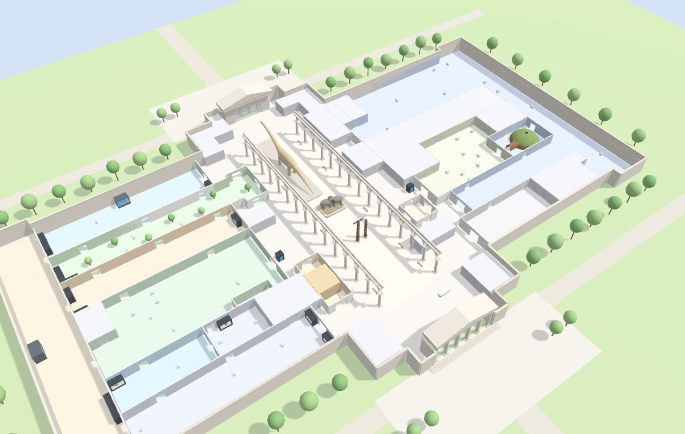
  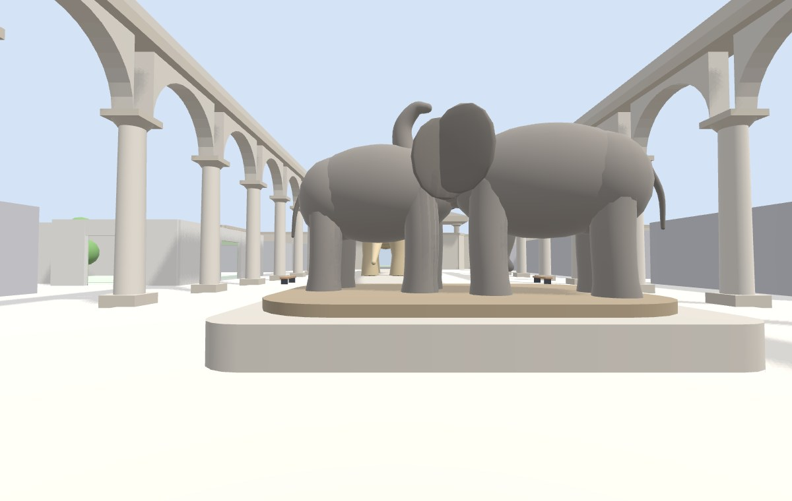
</p>
<p align="center">
  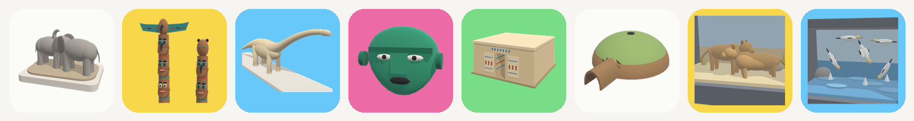
</p>

## Admin panel for museum staff

<p align="center">
  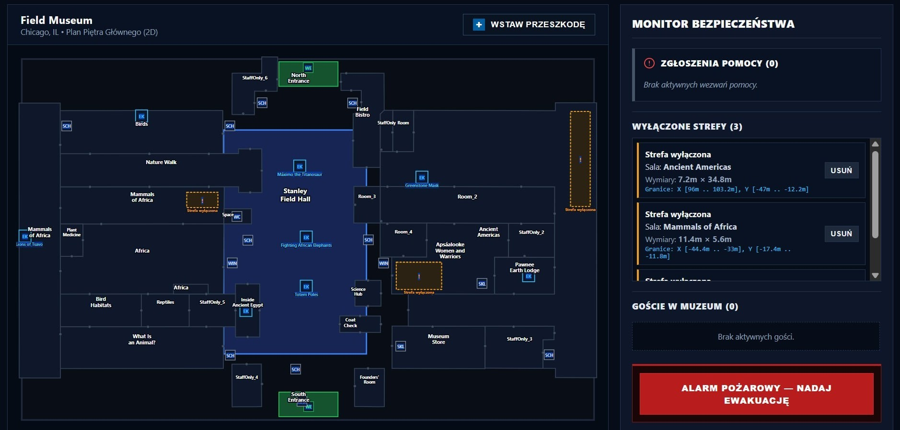
</p>

- **Closed zones:** mark a closed room or an obstacle on the floor plan; routes on the server go around it.
- **Help requests:** visitors' calls for help arrive in one place.
- **Visitors in the museum:** who is in the building right now.
- **Fire alarm:** one button starts an evacuation and sends routes to the nearest exit.

## How it fits together

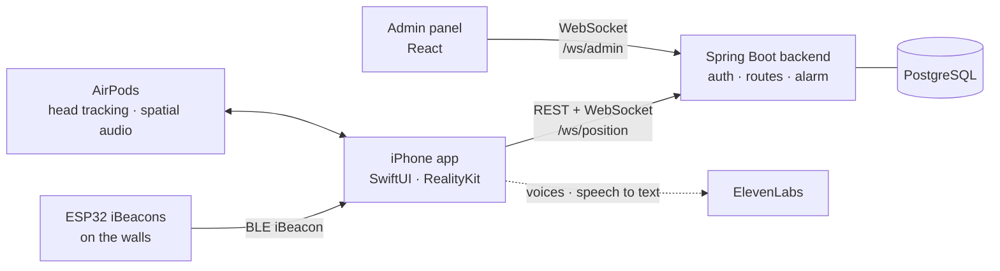

| Part | What's inside |
|---|---|
| **iOS app** | SwiftUI + RealityKit 3D map, HRTF spatial audio (`AVAudioEnvironmentNode`), AirPods head tracking (`CMHeadphoneMotionManager`), iBeacon ranging (Core Location), step detection from the motion sensors fused with the beacons in a Kalman filter, ElevenLabs voices and speech-to-text, wake phrase on Apple's on-device recogniser. |
| **Backend** | Spring Boot 4 on Java 25 with PostgreSQL. Session login (CSRF + cookie), shortest routes on a 0.2 m grid of the floor plan with turn-by-turn points, closed zones, fire alarm with routes to the exits, help requests, live positions for the panel. Swagger UI included. |
| **Admin panel** | React 19 + Vite. Live floor plan, closed zones, help requests, visitors, alarm. |
| **Beacons** | ESP32 boards broadcasting iBeacon frames (one shared UUID, a unique minor per board, +9 dBm, every 100 ms). |

> [!NOTE]
> The iOS app works out where you are on the phone itself (beacons + steps). Its live connection to the backend
> (`/ws/position`, server routes, closed zones and the alarm on the phone) is written but not switched on in the
> current build.

## Repository

```
.
├── mobile/BestHackMobile/      iOS app (Xcode project), details in its README
├── backend/java-backend/       Spring Boot backend + API docs (in Polish)
├── frontendWeb/frontendWeb/    admin panel (React + Vite)
├── embedded/ble_beacon/        ESP32 iBeacon firmware (Arduino)
├── docker-compose.yml          backend + PostgreSQL in one command
└── docs/readme/                pictures for this README
```

## Getting started

**1. Backend + database** (Docker)

```bash
cp .env.example .env              # then set a real POSTGRES_PASSWORD
docker compose up -d --build      # backend on http://<this computer's IP>:8081
```

Swagger UI is at `/swagger-ui/index.html`. To make an account an administrator:

```bash
docker compose exec db psql -U museum -d museum \
  -c "UPDATE app_users SET role = 'ADMIN' WHERE email = 'you@example.com';"
```

**2. Admin panel**

```bash
cd frontendWeb/frontendWeb
npm install
npm run dev
```

Point it at the backend's address and log in with an `ADMIN` account.

**3. Beacons**

Open `embedded/ble_beacon/ble_beacon.ino` in the Arduino IDE (ESP32 board package), set a unique `BEACON_ID` for
each board and flash it. For better distances, set `MEASURED_POWER_1M` to the signal an iPhone reads 1 m away.

**4. iOS app**

1. Open `mobile/BestHackMobile/BestHackMobile.xcodeproj` in Xcode 27.
2. Copy `mobile/BestHackMobile/Secrets.example.plist` to `mobile/BestHackMobile/BestHackMobile/Config/Secrets.plist`
   and fill in what you have (all optional): `ELEVENLABS_API_KEY` for natural voices and voice commands,
   `BACKEND_URL` for your server (it can also be set on the login screen).
3. Run it on an iPhone with head-tracking AirPods. Beacons need a real iPhone, not the Simulator. No beacons yet?
   Turn on **Demo walk** in Settings, or type in your own beacon layout under **Settings → Beacon layout and steps**.

## Headphones

The prototype runs on AirPods because that was the fastest way to test. Head-tracking headphones are no longer a
luxury: models with motion sensors start at around 350 zł. On iPhone the app reads head movement from AirPods
(3rd generation and newer, Pro, Max) and Beats with head tracking; other brands need an Android version, which is
our next step.

## Who it's for

- **Blind visitors**, our main group, but not the only one.
- **People on the autism spectrum or with sensory sensitivity:** noise cancelling shuts out the crowd and directional
  sound helps to focus on one object.
- **Foreign tourists:** the language changes with one tap, so an investment in accessibility also serves
  international visitors.

## Credits

- Floor plan data © 2020 Field Museum of Natural History, [CC BY 4.0](https://creativecommons.org/licenses/by/4.0/).
  The building and exhibit models are simplified reconstructions, not scans.
- Voices and speech recognition by [ElevenLabs](https://elevenlabs.io).

<p align="center">
  <br>
  <b>Hear the unseen.</b> You don't need to see to fully feel and understand culture.
</p>
