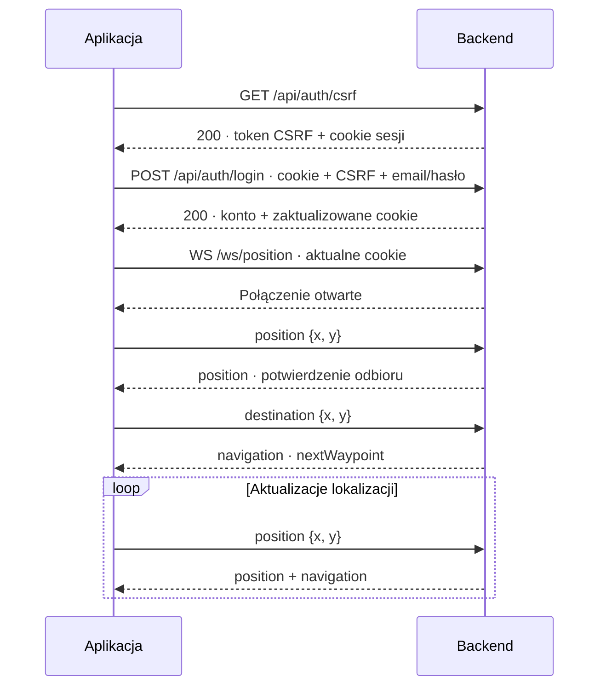

# Backend muzeum — instrukcja integracji

**Dla zespołu aplikacji iOS i panelu administratora**  
Stan kontraktu: **10 października 2026** · HTTP JSON + WebSocket JSON · jedno piętro

> **Najważniejsze:** backend loguje przez sesję i cookie `JSESSIONID`, a nie JWT.
> Najpierw pobierz CSRF i zaloguj konto. Następnie przekaż cookie sesji przy otwieraniu
> WebSocketu. Wszystkie współrzędne przesyłaj w **metrach, w układzie mapy muzeum**.

## Spis treści

1. [Adresy i lista połączeń](#1-adresy-i-lista-połączeń)
2. [Sesja, CSRF i role](#2-sesja-csrf-i-role)
3. [Endpointy HTTP](#3-endpointy-http)
4. [Mapa i współrzędne](#4-mapa-i-współrzędne)
5. [WebSocket użytkownika](#5-websocket-użytkownika)
6. [Odpowiedź nawigacji](#6-odpowiedź-nawigacji)
7. [WebSocket administratora](#7-websocket-administratora)
8. [Alarm i wyłączone strefy](#8-alarm-i-wyłączone-strefy)
9. [Błędy i ponowne łączenie](#9-błędy-i-ponowne-łączenie)
10. [Szybki test integracji](#10-szybki-test-integracji)
11. [Lista kontrolna dla aplikacji](#11-lista-kontrolna-dla-aplikacji)

---

## 1. Adresy i lista połączeń

| Zastosowanie | Adres lokalny |
|---|---|
| Baza HTTP | `http://localhost:8081` |
| Nawigacja użytkownika | `ws://localhost:8081/ws/position` |
| Panel administratora | `ws://localhost:8081/ws/admin` |
| Swagger UI | `http://localhost:8081/swagger-ui/index.html` |
| OpenAPI JSON | `http://localhost:8081/v3/api-docs` |

Na fizycznym telefonie `localhost` oznacza telefon. Użyj adresu komputera z backendem,
np. `http://192.168.1.20:8081`, i tego samego hosta dla HTTP oraz WS. Przykładowy adres
IP należy zastąpić rzeczywistym adresem środowiska. Dla środowiska z TLS używaj pary
`https://` i `wss://`.

### Endpointy biznesowe

| Metoda | Ścieżka | Dostęp | CSRF | Poprawna odpowiedź |
|---|---|---|---|---|
| `POST` | `/api/auth/register` | Publiczny | Nie | `201` + konto |
| `GET` | `/api/auth/csrf` | Publiczny | Nie | `200` + token |
| `POST` | `/api/auth/login` | Publiczny | **Tak** | `200` + konto |
| `GET` | `/api/auth/me` | Zalogowany | Nie | `200` + konto |
| `POST` | `/api/auth/logout` | Zalogowany | **Tak** | `204`, bez body |

### Kanały WebSocket

| Ścieżka | Dostęp | Klient → backend | Backend → klient |
|---|---|---|---|
| `/ws/position` | `USER` lub `ADMIN` | `position`, `destination`, `cancel`, `help` | `position`, `navigation`, `policy`, `help.accepted`, `error` |
| `/ws/admin` | Tylko `ADMIN` | `snapshot`, `alarm`, `zone.add`, `zone.remove` | `positions`, `policy`, `help.request`, `error` |

Zgłoszenia pomocy: aplikacja wysyła `{"type":"help"}` (opcjonalnie z `x`, `y`),
backend odpowiada `help.accepted` i przekazuje `help.request` do podłączonych administratorów.
Format pól, przykłady i ograniczenia dostarczania: [HELP_REQUESTS.md](HELP_REQUESTS.md).

To zwykłe WebSockety z tekstowymi wiadomościami JSON — bez STOMP, SockJS i nazw tematów.
Jedna wiadomość zawiera jeden obiekt JSON. Swagger służy do HTTP; nie jest klientem WS.
Otworzenie `ws://...` w pasku przeglądarki nie wystarczy do wysyłania wiadomości.

Backend nie udostępnia obecnie endpointu pobierania mapy, listy POI ani pełnej tablicy
trasy. Aplikacja korzysta z uzgodnionego pliku mapy; WS zwraca następny punkt kierowania.

## 2. Sesja, CSRF i role

### Co jest czym?

| Wartość | Do czego służy | Jak ją przesyłać |
|---|---|---|
| `JSESSIONID` | Wiąże żądanie z sesją użytkownika | Cookie HTTP, również podczas handshake WS |
| Token CSRF | Chroni żądania logowania i wylogowania | Nagłówek wskazany przez `/csrf`, obecnie `X-CSRF-TOKEN` |
| `role` | Informuje, czy konto ma rolę `USER` czy `ADMIN` | Odczytaj z odpowiedzi konta; uprawnienia sprawdza serwer |
| `routeId` | Identyfikuje aktualnie wyznaczoną trasę | Odczytaj z `navigation`; to nie token logowania |

### Kolejność logowania

1. Wywołaj `GET /api/auth/csrf`. Zachowaj zwrócone cookie sesji i pole `token`.
2. Wywołaj `POST /api/auth/login` z tym cookie, tokenem CSRF w nagłówku i danymi konta.
3. Po sukcesie zaktualizuj cookie zgodnie z `Set-Cookie`: **logowanie zmienia identyfikator sesji**.
4. Opcjonalnie potwierdź sesję przez `GET /api/auth/me`.
5. Otwórz WS z aktualnym cookie. W wiadomościach WS nie przesyłaj CSRF, hasła ani roli.
6. Przed wylogowaniem ponownie pobierz `/csrf`, ponieważ logowanie unieważnia stary token.
7. Wykonaj `POST /api/auth/logout` ze świeżym CSRF i cookie, a następnie zamknij lokalne WS.



### iOS i przeglądarka

- **Natywny iOS:** klient HTTP i klient WS muszą korzystać z cookie tej samej sesji.
  Dopilnuj obsługi `Set-Cookie` także po logowaniu. Jeśli klient WS nie korzysta ze wspólnego
  magazynu cookies, dołącz aktualne `Cookie: JSESSIONID=...` do żądania otwierającego WS.
- CSRF nadal jest wymagany przy HTTP login/logout w obecnej konfiguracji, także dla iOS.
  Nie jest zamiennikiem cookie sesji ani tokenem Bearer.
- **Przeglądarka:** używaj `credentials: "include"` dla HTTP. Cookie `HttpOnly` nie jest
  odczytywane przez JavaScript; przeglądarka przekazuje je przy odpowiednich żądaniach.
- Obecna konfiguracja przeglądarkowa zakłada ten sam origin. Dla osobnej domeny/portu
  frontendu potrzebna jest uzgodniona konfiguracja CORS i dozwolonego originu WS lub proxy.
  Samo `credentials: "include"` nie omija ograniczeń originu.

### Czas życia i uprawnienia

Sesja ma skonfigurowane **30 minut bezczynności**, a cookie `HttpOnly` i `SameSite=Lax`.
Nie zakładaj, że samo wysyłanie pozycji przez WS odnawia czas sesji HTTP. Obsłuż jej wygaśnięcie.
Logout i restart backendu unieważniają sesję.

Nowe konta zawsze otrzymują `USER`. Administrator jest nadawany poza publicznym API,
zgodnie z [ADMIN.md](ADMIN.md). Zmiana roli w bazie wymaga ponownego logowania, aby
zaktualizować uprawnienia istniejącej sesji. `/me` odczytuje rolę konta z bazy, więc po
administracyjnej zmianie roli wynik `/me` może chwilowo różnić się od uprawnień starej sesji.

## 3. Endpointy HTTP

Przy żądaniach z body JSON ustaw `Content-Type: application/json`.
Przykładowe identyfikatory, adresy email i tokeny w tym dokumencie są poglądowe.

### `POST /api/auth/register` — utworzenie konta

**Dostęp:** publiczny, bez CSRF. Rejestracja nie loguje automatycznie.

```json
{
  "email": "user@example.com",
  "password": "TestoweHaslo123!"
}
```

| Pole | Wymagania |
|---|---|
| `email` | Wymagany, poprawny email, maks. 254 znaki; backend usuwa skrajne białe znaki i zamienia litery na małe |
| `password` | Wymagane, 8–72 znaki oraz maks. **72 bajty UTF-8**; nie jest przycinane ani normalizowane |

**Odpowiedź `201 Created`:**

```json
{"id":1,"email":"user@example.com","role":"USER"}
```

**Błędy:** `400` — niepoprawne dane; `409` — email już zajęty.
Nie przesyłaj pola `role`; publiczna rejestracja nie przyznaje uprawnień administratora.

### `GET /api/auth/csrf` — token dla bieżącej sesji

**Dostęp:** publiczny. Bez body.

**Odpowiedź `200 OK`:**

```json
{"headerName":"X-CSRF-TOKEN","token":"wartosc-tokena-z-serwera"}
```

Zachowaj cookie z tej odpowiedzi. Token jest powiązany z sesją, z której go pobrano.
Nie używaj tokenu jednego klienta z cookie innego klienta. Odpowiedź ma `Cache-Control: no-store`.

### `POST /api/auth/login` — rozpoczęcie zalogowanej sesji

**Wymaga:** cookie z `/csrf` oraz nagłówka `X-CSRF-TOKEN` z aktualnym tokenem.

```http
POST /api/auth/login
Content-Type: application/json
Cookie: JSESSIONID=aktualna-sesja
X-CSRF-TOKEN: token-dla-tej-sesji
```

```json
{"email":"user@example.com","password":"TestoweHaslo123!"}
```

Email podlega takiej samej normalizacji jak przy rejestracji. Hasło musi być niepuste,
mieć maks. 72 znaki i maks. 72 bajty UTF-8.

**Odpowiedź `200 OK`:**

```json
{"id":1,"email":"user@example.com","role":"USER"}
```

Dla administratora pole `role` ma wartość `ADMIN`. Zaktualizuj cookie sesji z odpowiedzi.
W body nie ma JWT ani osobnego tokenu sesji. Odpowiedź ma `Cache-Control: no-store`.

**Błędy:** `400` — walidacja danych; `401` — błędny email lub hasło;
`403` — brak lub niepoprawny CSRF, w tym token z innej sesji.

### `GET /api/auth/me` — sprawdzenie konta i sesji

**Wymaga:** cookie zalogowanej sesji. Bez body i bez CSRF.

**Odpowiedź `200 OK`:**

```json
{"id":1,"email":"user@example.com","role":"USER"}
```

**Błąd:** `401` — brak ważnego zalogowania lub konto nie istnieje.
Odpowiedź ma `Cache-Control: no-store`.

### `POST /api/auth/logout` — zakończenie sesji

**Wymaga:** cookie zalogowanej sesji i świeżego tokenu z `/csrf`. Bez body.

**Odpowiedź:** `204 No Content`. Nie próbuj dekodować jej jako JSON.

Sesja zostaje unieważniona. Aplikacja powinna usunąć stan zalogowania oraz nawigacji
i zamknąć własne połączenia WS. Logout administratora nie odwołuje alarmu ani stref.

**Błędy:** `403` przy niepoprawnym CSRF; `401` przy braku zalogowania, jeśli CSRF przeszedł
walidację. Filtr CSRF może zwrócić `403` przed sprawdzeniem zalogowania.

### Format błędów HTTP

Błędy obsługiwane przez kontroler używają struktury `ProblemDetail`, np.:

```json
{
  "type":"about:blank",
  "title":"Conflict",
  "status":409,
  "detail":"Konto z tym adresem e-mail już istnieje.",
  "instance":"/api/auth/register"
}
```

Podstawą obsługi jest kod HTTP. Treść błędów filtrów bezpieczeństwa, niepoprawnego JSON
czy innych błędów frameworka może mieć inny format. Nie uzależniaj działania od dokładnego
polskiego komunikatu ani obecności wszystkich pól przykładu.

## 4. Mapa i współrzędne

Plik używany przez backend: [field-museum-main-level.grid.json](src/main/resources/maps/field-museum-main-level.grid.json).
Aplikacja i backend muszą korzystać z tej samej aktualnej wersji pliku.

| Parametr | Wartość |
|---|---|
| `mapId` | `field-museum-main-level` |
| Jednostka | Metry |
| Rozmiar komórki | `0.2 × 0.2 m` |
| Rozmiar siatki | 1066 kolumn × 681 wierszy |
| Początek siatki | `x = -106.6`, `y = -68.2` |
| Zakres współrzędnych | `-106.6 ≤ x < 106.6`, `-68.2 ≤ y < 68.0` |
| Powiązanie z modelem | `x = X`, `y = Z`; wiersze rosną w kierunku rosnącego `y` |
| Sugerowany start | `(0.1, 55.9)` |
| Wyjście południowe | `(0.3, 59.9)` |
| Wyjście północne | `(0.1, -61.9)` |

Wysyłaj **współrzędne świata mapy**, nie indeksy komórek, piksele ani surowe współrzędne
lokalnego układu ARKit. Aplikacja odpowiada za dopasowanie swojej lokalizacji do modelu.
Współrzędne ujemne są poprawne. Wszystkie wartości `x`, `y` muszą być skończonymi liczbami JSON.

```text
column = floor((x + 106.6) / 0.2)
row    = floor((y + 68.2) / 0.2)

x = -106.6 + (column + 0.5) * 0.2
y =  -68.2 + (row    + 0.5) * 0.2
```

Tylko kod komórki `1` oznacza przestrzeń przechodnią. Kody `0`, `2`, `3`, `4`, `5`
są zablokowane. Punkt na granicy zablokowanej komórki też może być odrzucony.
Obecna mapa zawiera już bufor 1 m dla środków przechodnich komórek przy przeszkodach.

**Cele eksponatów:** wybieraj `pointsOfInterest[].approach.x/y`, a nie pozycję samego
eksponatu z `position`. Przy `approach: null` punkt jest niedostępny. W tej wersji mapy
dostępne są 24 z 25 punktów; `restroom` ma `approach: null`.

Identyfikator `mapId` nie zmienił się przy podmianie mapy. Samo jego porównanie nie
wykrywa starego pliku w aplikacji. `policyRevision` również nie jest wersją pliku mapy.

## 5. WebSocket użytkownika

**Adres:** `/ws/position` · **Dostęp:** zalogowane konto `USER` lub `ADMIN`  
**Limit przychodzącej wiadomości tekstowej:** 1024 bajty

Tożsamość użytkownika pochodzi z sesji. Nie dodawaj `userId`, `email`, `role`, `requestId`
ani własnego znacznika czasu do poniższych wiadomości — dodatkowe pola są odrzucane.

### `position` — aktualna lokalizacja

Klient → backend:

```json
{"type":"position","x":0.1,"y":55.9}
```

Obsługiwany starszy zapis:

```json
{"x":0.1,"y":55.9}
```

Backend → nadawca:

```json
{"type":"position","x":0.1,"y":55.9,"receivedAt":"2026-10-10T20:00:00Z"}
```

`receivedAt` jest czasem odbioru na serwerze w UTC, nie czasem pomiaru telefonu.
Potwierdza przyjęcie liczbowych współrzędnych, **nie gwarantuje**, że punkt jest przechodni.
Przy aktywnej nawigacji niepoprawne położenie na mapie będzie zgłoszone osobno w `navigation`.

Po potwierdzeniu może nadejść `navigation`, jeśli istnieje cel, trwa alarm lub działają
strefy. Administratorzy otrzymują wtedy aktualizację `positions` na swoim kanale.

### `destination` — wybór celu

```json
{"type":"destination","x":0.1,"y":-61.9}
```

Odpowiedzią jest `navigation`, bez osobnego potwierdzenia `destination`.
Cel można wysłać przed pozycją — wtedy status to `awaiting_position`.

Cel poza mapą lub w statycznej przeszkodzie zwraca `error` i nie zastępuje poprzedniego
celu. Cel znajdujący się w dynamicznej strefie może zostać zapamiętany i spowodować
`navigation` ze statusem `blocked` lub `escaping`; po usunięciu strefy trasa może wrócić.

### `cancel` — anulowanie zwykłego celu

```json
{"type":"cancel"}
```

Zwykle zwraca `navigation` ze statusem `cancelled`. Podczas alarmu nawigacja do wyjścia
trwa nadal. Jeśli użytkownik pozostaje w wyłączonej strefie, wyprowadzanie również może
trwać mimo usunięcia zwykłego celu.

### Zdarzenia niezależne od żądania

Zmiana alarmu lub stref przez administratora powoduje wysłanie `policy`, a następnie
nowego `navigation`, jeżeli backend zna już stan danego połączenia.
Po otwarciu WS użytkownik dostaje `policy` tylko wtedy, gdy jest aktywny alarm lub istnieją
strefy. **Nie czekaj na wiadomość powitalną przed wysłaniem pozycji.**

Protokół nie ma identyfikatorów żądań. Utrzymuj ciągłą pętlę odbioru i rozdzielaj
wiadomości po `type`; nie zakładaj, że każda odebrana wiadomość jest odpowiedzią na
ostatnie wysłane żądanie. Aplikacja może dostawać ponownie ten sam `nextWaypoint`.

## 6. Odpowiedź nawigacji

Przykład struktury — identyfikator i wartości trasy są poglądowe; rzeczywistą trasę
wyznacza backend na podstawie aktualnej pozycji, mapy i stref:

```json
{
  "type":"navigation",
  "status":"navigating",
  "mapId":"field-museum-main-level",
  "routeId":"2b421820-e94a-4c49-9295-f6fb47d07336",
  "destination":{"x":0.3,"y":59.9},
  "nextWaypoint":{"x":0.3,"y":59.9},
  "waypointIndex":0,
  "waypointCount":1,
  "distanceToWaypointM":4.005,
  "remainingDistanceM":4.005,
  "recalculated":true,
  "reason":null,
  "waypointToleranceM":0.4,
  "arrivalToleranceM":0.3,
  "alarmActive":false,
  "policyRevision":0
}
```

### Pola

| Pole | Typ | Znaczenie |
|---|---|---|
| `type` | string | `navigation` |
| `status` | string | Stan opisany w tabeli poniżej |
| `mapId` | string | Identyfikator mapy |
| `routeId` | string lub null | Id wyznaczonej trasy; może zmienić się po przeliczeniu |
| `destination` | `{x,y}` lub null | Bieżący cel; podczas alarmu wybrane wyjście |
| `nextWaypoint` | `{x,y}` lub null | Punkt, do którego aplikacja ma aktualnie prowadzić |
| `waypointIndex` | integer lub null | Indeks punktu od **zera** |
| `waypointCount` | integer | Liczba punktów wyznaczonej trasy, bez startu, z celem |
| `distanceToWaypointM` | number lub null | Odległość od bieżącej pozycji do następnego punktu |
| `remainingDistanceM` | number lub null | Pozostała długość łamanej; `0` przy dotarciu |
| `recalculated` | boolean | Czy w tej odpowiedzi wyznaczono trasę ponownie |
| `reason` | string lub null | Kod powodu blokady albo ograniczenia przy wyprowadzaniu |
| `waypointToleranceM` | number | Tolerancja punktu pośredniego, obecnie `0.4` |
| `arrivalToleranceM` | number | Tolerancja celu, obecnie `0.3` |
| `alarmActive` | boolean | Czy trwa alarm |
| `policyRevision` | integer | Wersja stanu alarmu i stref użyta do nawigacji |

Dekoduj pola oznaczone jako nullable jako opcjonalne. Nie zastępuj brakującego punktu
współrzędnymi `(0,0)` — to rzeczywista lokalizacja na mapie.

### Statusy i oczekiwana reakcja aplikacji

| `status` | Znaczenie | Reakcja aplikacji |
|---|---|---|
| `awaiting_position` | Cel znany, brak lokalizacji | Wyślij aktualną pozycję; nie pokazuj starej strzałki |
| `navigating` | Trasa dostępna | Prowadź do `nextWaypoint` |
| `escaping` | Wyprowadzanie ze strefy, dalszy cel niedostępny lub niewybrany | Prowadź do `nextWaypoint`; uwzględnij `reason` |
| `arrived` | Osiągnięty cel w granicach tolerancji | Zakończ wskazówkę nawigacji |
| `blocked` | Brak obecnie dostępnej instrukcji przejścia | Usuń starą strzałkę i pokaż powód; nadal wysyłaj pozycję |
| `cancelled` | Zwykły cel anulowany | Usuń trasę i wskazówkę |
| `idle` | Brak aktywnego celu | Usuń poprzednią wskazówkę |

W `escaping` pole `destination` może nadal wskazywać zablokowany cel albo być null.
`remainingDistanceM` dotyczy wówczas drogi wyprowadzenia. Samo wyjście ze strefy może też
być początkiem normalnej trasy `navigating`, jeśli dalszy cel jest osiągalny.

### Kiedy zmienia się punkt?

Backend używa A* po siatce i wygładza trasę do prostych odcinków. `nextWaypoint` jest
punktem zmiany kierunku lub celem, a nie następną kratką. Odcinki mogą być ukośne.
Backend zmienia punkt po dojściu do zakrętu lub rozpoznaniu wejścia na kolejny odcinek,
z uwzględnieniem tolerancji i braku przeszkód.

Przy odchyleniu od odcinka o ponad `0.75 m` lub zablokowaniu dalszego przejścia trasa
jest przeliczana. Zmiana stref również wymusza aktualizację. Aplikacja nie musi
samodzielnie wyznaczać kolejnych zakrętów ani wysyłać komendy „punkt osiągnięty”.

## 7. WebSocket administratora

**Adres:** `/ws/admin` · **Dostęp:** tylko `ADMIN`  
**Limit przychodzącej wiadomości tekstowej:** 2048 bajtów

Po otwarciu administrator otrzymuje `policy`, a następnie `positions`.
Te wiadomości mogą później przychodzić bez żądania. Konto `USER` otrzyma HTTP `403`
przy próbie handshake. Konto `ADMIN` używa tego samego sposobu logowania co użytkownik.

### `positions` — pełny zestaw lokalizacji

```json
{
  "type":"positions",
  "users":[
    {"username":"user@example.com","x":0.1,"y":55.9,"receivedAt":"2026-10-10T20:00:00Z"}
  ]
}
```

- Każda wiadomość jest **pełnym zestawem**, nie listą zmian. Zastąp nią poprzednią listę.
- `users: []` oznacza brak dostępnych lokalizacji aktywnych kont.
- `username` to email konta; używaj go jako klucza wpisu. Nie ma pola `userId`.
- Konto pojawia się po przesłaniu pozycji przez aktywne `/ws/position`.
- Przy kilku połączeniach tego samego konta pokazywana jest najnowsza pozycja. Po zamknięciu
  jednego połączenia może pozostać starsza pozycja z innego, wciąż aktywnego połączenia.
- Nie ma historii ruchu ani osobnej wiadomości „użytkownik zniknął”. Obserwuj pełny zestaw
  i wiek `receivedAt`. Pozycje administratorów korzystających z `/ws/position` też mogą się pojawić.

### `snapshot` — ponowne pobranie stanu

```json
{"type":"snapshot"}
```

Nadawca otrzymuje `policy` i `positions`. Aktualizacja `positions` jest przy tej komendzie
rozsyłana również do pozostałych podłączonych administratorów.

### `alarm` — włączenie lub odwołanie alarmu

```json
{"type":"alarm","active":true}
```

```json
{"type":"alarm","active":false}
```

`active` musi być wartością logiczną JSON, nie stringiem. Poprawną komendę potwierdza
stan `policy`; nie ma oddzielnej wiadomości `ack`. Ponowne ustawienie tej samej wartości
nie zwiększa `revision`, ale może ponownie rozesłać bieżący stan.

### `zone.add` — dodanie wyłączonego prostokąta

```json
{"type":"zone.add","minX":10,"minY":10,"maxX":14,"maxY":16}
```

Wszystkie cztery współrzędne są wymaganymi skończonymi liczbami w metrach.
Musi zachodzić `minX < maxX` i `minY < maxY`, a prostokąt musi mieścić się w granicach mapy.
Może obejmować przeszkody oraz przecinać inne strefy. Limit to **100 aktywnych stref**.

Serwer nadaje `id` UUID. Odpowiedź `policy` zawiera pełną listę stref, w tym nową.
Nie nadawaj `id` po stronie klienta. Ponowienie `zone.add` tworzy kolejny prostokąt:
po niepewności związanej z utratą połączenia najpierw pobierz `snapshot`.

### `zone.remove` — usunięcie strefy

```json
{"type":"zone.remove","id":"6a061e47-3d2b-4c8f-a7ca-71583e9435d5"}
```

Użyj rzeczywistego identyfikatora z `policy.zones`. Usunięcie nieistniejącej strefy
zwraca `ZONE_NOT_FOUND`. Poprawne usunięcie powoduje wysłanie aktualnego `policy`.

### `policy` — wspólny stan alarmu i stref

Administrator otrzymuje ten typ przy połączeniu, na żądanie oraz po komendach
administracyjnych. Użytkownik otrzymuje go po zmianach i przy połączeniu z aktywną polityką.

```json
{
  "type":"policy",
  "revision":3,
  "alarmActive":true,
  "zones":[
    {"id":"6a061e47-3d2b-4c8f-a7ca-71583e9435d5","minX":10.0,"minY":10.0,"maxX":14.0,"maxY":16.0}
  ],
  "exits":[{"x":0.3,"y":59.9},{"x":0.1,"y":-61.9}]
}
```

| Pole | Znaczenie |
|---|---|
| `revision` | Rośnie przy zmianie alarmu lub listy stref; resetuje się po restarcie backendu |
| `alarmActive` | Stan alarmu dla całego obiektu |
| `zones` | Pełna lista prostokątów, w wymiarach podanych przez administratorów |
| `exits` | Punkty wyjść wczytane z mapy; lista nie oznacza, że każde wyjście jest aktualnie osiągalne |

Zastępuj lokalny stan listami z wiadomości. Nie traktuj `revision` jako identyfikatora
żądania ani wersji geometrii mapy. Po ponownym połączeniu przyjmij nowy stan nawet wtedy,
gdy numer jest niższy niż zapamiętany przed restartem.

## 8. Alarm i wyłączone strefy

### Alarm

1. Administrator wysyła `alarm` z `active: true`.
2. Użytkownicy otrzymują `policy` z aktywnym alarmem.
3. Backend wyznacza trasy do dostępnych wyjść i wybiera najkrótszą spośród znalezionych tras.
4. Użytkownik otrzymuje `navigation` z `alarmActive: true` i wyjściem jako `destination`.
5. Po odwołaniu alarmu wraca zapamiętany zwykły cel albo status `idle`, gdy nie ma celu.

Alarm działa również bez wcześniej wybranego celu i dla użytkowników dołączających
w jego trakcie. Do wyznaczenia drogi potrzebna jest pozycja. Punkty wyjść pochodzą
z `approach` dwóch POI rodzaju `entrance` w mapie.

Podczas alarmu `destination` zapamiętuje zwykły cel na później, ale nie zastępuje wyjścia.
`cancel` usuwa zwykły cel, ale nie odwołuje alarmu. Aplikacja powinna kierować na podstawie
aktualnego `nextWaypoint`, a nie zapamiętanego celu z własnego interfejsu.

### Strefy

Backend powiększa prostokąt o **0,3 m marginesu** i obejmuje blokadą odpowiednie komórki
siatki. Faktycznie zablokowany obszar jest więc większy niż prostokąt w `policy.zones`.
Dodanie i usunięcie strefy wysyła aktualizację nawigacji bez czekania na nową pozycję.

Gdy strefa powstanie pod użytkownikiem, backend pozwala wyjść z niej, ale nie prowadzi
z powrotem do środka. Jeśli dalszy cel jest niedostępny, najpierw wyprowadza użytkownika,
a następnie zgłasza blokadę. Jeśli nie da się nawet opuścić strefy, zwraca `NO_ESCAPE_ROUTE`.

### Przechowywanie

| Dane | Czas życia |
|---|---|
| Konta i role | PostgreSQL; pozostają po restarcie |
| Sesje logowania | Pamięć jednej instancji; do wygaśnięcia, logoutu lub restartu |
| Alarm i strefy | Pamięć jednej instancji; reset po restarcie |
| Pozycja i cel nawigacji | Stan połączenia `/ws/position`; usuwany po jego zamknięciu |
| Mapa | Plik w backendzie, ładowany przy uruchomieniu |

Rozłączenie administratora nie usuwa stref ani alarmu. Zamknięcie i ponowne otwarcie
WS użytkownika nie przywraca jego zwykłego celu automatycznie.

## 9. Błędy i ponowne łączenie

### Błąd komendy WebSocket

```json
{"type":"error","code":"INVALID_POSITION","message":"Wyślij skończone współrzędne x i y w metrach."}
```

`error` oznacza odrzucenie wiadomości. Zwykle można poprawić dane i wysłać je na tym
samym połączeniu. `navigation` ze statusem `blocked` to osobny przypadek: wiadomość mogła
być poprawna, ale droga jest niedostępna. Kieruj logiką po `code` lub `reason`, nie treścią `message`.

| Kod | Gdzie występuje | Znaczenie |
|---|---|---|
| `INVALID_POSITION` | `error` użytkownika | Niepoprawny JSON, pola, typy lub liczby pozycji/celu |
| `UNSUPPORTED_MESSAGE` | `error` użytkownika | Nieobsługiwana komenda; dotyczy też części niepoprawnych wariantów `cancel` |
| `INVALID_HELP` | `error` użytkownika | Niepoprawne pola zgłoszenia `help`; wymagane samo `type` lub `type`, `x`, `y` |
| `DESTINATION_OUTSIDE_MAP` | `error` użytkownika | Cel poza mapą |
| `DESTINATION_BLOCKED` | `error`, `navigation.reason` | Cel w przeszkodzie, na jej granicy lub w strefie |
| `POSITION_OUTSIDE_MAP` | `navigation.reason` | Aktualna pozycja poza mapą |
| `POSITION_BLOCKED` | `navigation.reason` | Aktualna pozycja w statycznie zablokowanej przestrzeni |
| `NO_ROUTE` | `navigation.reason` | Brak dostępnej trasy do celu |
| `NO_REACHABLE_EXIT` | `navigation.reason` | Podczas alarmu brak osiągalnego wyjścia |
| `NO_ESCAPE_ROUTE` | `navigation.reason` | Nie można opuścić strefy |
| `INVALID_COMMAND` | `error` administratora | Nieznana komenda lub niepoprawna struktura/pola |
| `INVALID_ZONE` | `error` administratora | Prostokąt o niepoprawnych granicach |
| `ZONE_LIMIT` | `error` administratora | Osiągnięto limit 100 stref |
| `ZONE_NOT_FOUND` | `error` administratora | Identyfikator usuwanej strefy nie istnieje |

### Błąd handshake i zamknięcie

| Sytuacja | Wynik / reakcja |
|---|---|
| Brak zalogowania przy handshake | HTTP `401`; sprawdź cookie i zaloguj ponownie |
| `USER` otwiera `/ws/admin` | HTTP `403`; wymagane uprawnienia administratora |
| Niedozwolony origin przeglądarki | HTTP `403`; sprawdź uzgodniony origin lub proxy |
| Wygaśnięcie/unieważnienie sesji | Zamknięcie WS `1008`; wyczyść stan i sprawdź logowanie |
| Błąd transportu po stronie handlera | Możliwe zamknięcie `1011` |
| Zbyt duża wiadomość lub dane binarne | Połączenie może zostać zamknięte; wysyłaj małe tekstowe JSON-y |

Kod `1008` może również wystąpić przy odrzuceniu połączenia przez mechanizm wysyłania,
dlatego po zamknięciu zweryfikuj sesję przez `/me`. Nie zakładaj jednego kodu dla każdego
problemu sieciowego. Backend nie ma własnej komendy JSON `ping`.

### Przywrócenie połączenia

1. Po błędzie transportu sprawdź `/api/auth/me` z aktualnym cookie.
2. Jeśli sesja wygasła, przejdź ponownie przez `/csrf` i `/login`.
3. Otwórz właściwy WS; zwiększaj odstęp między nieudanymi próbami zamiast zapętlać je natychmiast.
4. Użytkownik wysyła ponownie aktualną pozycję i wybrany cel. Administrator odbiera nowy
   `policy` i `positions`; w razie potrzeby wysyła `snapshot`.
5. Zastąp poprzednią wskazówkę nowym stanem serwera. Nie kontynuuj starej trasy przy `blocked`.

## 10. Szybki test integracji

Poniższy przykład uruchom w konsoli przeglądarki na stronie Swaggera tego backendu.
Konto musi już istnieć. Przykład używa aktualnego hosta, dzięki czemu zachowuje ten sam origin.

```javascript
async function request(path, options = {}) {
  const response = await fetch(path, { ...options, credentials: "include" });
  if (!response.ok) throw new Error(`HTTP ${response.status}: ${await response.text()}`);
  return response.status === 204 ? null : response.json();
}

const csrf = await request("/api/auth/csrf");
const account = await request("/api/auth/login", {
  method: "POST",
  headers: { "Content-Type": "application/json", [csrf.headerName]: csrf.token },
  body: JSON.stringify({ email: "user@example.com", password: "TestoweHaslo123!" })
});
console.log("Konto:", account);

const wsBase = `${location.protocol === "https:" ? "wss" : "ws"}://${location.host}`;
const positionSocket = new WebSocket(`${wsBase}/ws/position`);
positionSocket.onmessage = event => {
  const message = JSON.parse(event.data);
  switch (message.type) {
    case "position": console.log("Odebrana pozycja:", message); break;
    case "navigation": console.log("Stan i kolejny punkt:", message.status, message.nextWaypoint); break;
    case "policy": console.log("Alarm i strefy:", message); break;
    case "error": console.error(message.code, message.message); break;
    default: console.log("Nieznany typ:", message);
  }
};
positionSocket.onclose = event => console.log("WS zamknięty:", event.code, event.reason);
positionSocket.onerror = event => console.error("Błąd WS:", event);
positionSocket.onopen = () => {
  positionSocket.send(JSON.stringify({ type: "position", x: 0.1, y: 55.9 }));
  positionSocket.send(JSON.stringify({ type: "destination", x: 0.1, y: -61.9 }));
};
```

Kolejne lokalizacje wysyłaj z rzeczywistych pomiarów. `nextWaypoint` jest instrukcją,
nie zmierzoną pozycją — nie odsyłaj go jako pozycji bez faktycznego dojścia użytkownika.

Dla zalogowanego konta `ADMIN` można osobno otworzyć kanał panelu:

```javascript
const adminSocket = new WebSocket(`${wsBase}/ws/admin`);
adminSocket.onmessage = event => console.log("Panel:", JSON.parse(event.data));
adminSocket.onclose = event => console.log("Panel rozłączony:", event.code);
// Po otwarciu serwer sam wyśle policy i positions.
```

Gdy połączenie jest otwarte, pobranie stanu:

```javascript
adminSocket.send(JSON.stringify({ type: "snapshot" }));
```

Komendy alarmu i stref z rozdziału 7 wpływają na wszystkich połączonych użytkowników
danego backendu. Nie są lokalnym podglądem panelu.

Wylogowanie po zakończeniu testu:

```javascript
const logoutCsrf = await request("/api/auth/csrf");
await request("/api/auth/logout", {
  method: "POST",
  headers: { [logoutCsrf.headerName]: logoutCsrf.token }
});
positionSocket.close();
// Jeśli otwarto panel administratora, zamknij również adminSocket.
```

## 11. Lista kontrolna dla aplikacji

- [ ] HTTP i WS używają tego samego hosta i aktualnego cookie sesji.
- [ ] Login oraz logout wysyłają CSRF z tej samej sesji; token po logowaniu jest pobierany ponownie.
- [ ] Aplikacja odróżnia `USER` od `ADMIN` i obsługuje odmowę dostępu.
- [ ] Lokalizacja jest przeliczona do układu mapy w metrach, z osią `y` odpowiadającą `Z` modelu.
- [ ] Cele pochodzą z aktualnego `approach`; niedostępne POI są wyłączone z wyboru.
- [ ] Klient odbiera WS w pętli i rozdziela wiadomości po `type`.
- [ ] `policy` i `navigation` mogą nadejść bez nowego żądania klienta.
- [ ] Pola punktów, indeksu i odległości dopuszczają null; `204` nie jest dekodowane jako JSON.
- [ ] `blocked`, `cancelled`, `idle` i `arrived` usuwają poprzednią wskazówkę kierowania.
- [ ] `escaping` jest obsługiwane jako aktywne prowadzenie do `nextWaypoint`.
- [ ] Alarm ma pierwszeństwo przed zwykłym celem i anulowaniem przez użytkownika.
- [ ] Panel zastępuje pełne listy `positions.users` i `policy.zones`, zamiast je dopisywać.
- [ ] Reconnect przywraca pozycję i cel; po restarcie akceptowana jest nowa numeracja `revision`.

---

### Powiązane pliki

- [AUTH.md](AUTH.md) — testowanie logowania w Swaggerze.
- [WEBSOCKET.md](WEBSOCKET.md) — podstawy połączenia z lokalizacją.
- [NAVIGATION.md](NAVIGATION.md) — szczegóły nawigacji i aktualnej mapy.
- [ADMIN.md](ADMIN.md) — konfiguracja konta administratora, alarm i strefy.

Dokument opisuje obecny kontrakt backendu, w tym ograniczenia sesji i danych w pamięci.
Nie wymaga dodania nowych endpointów ani zmiany formatu istniejących wiadomości.
